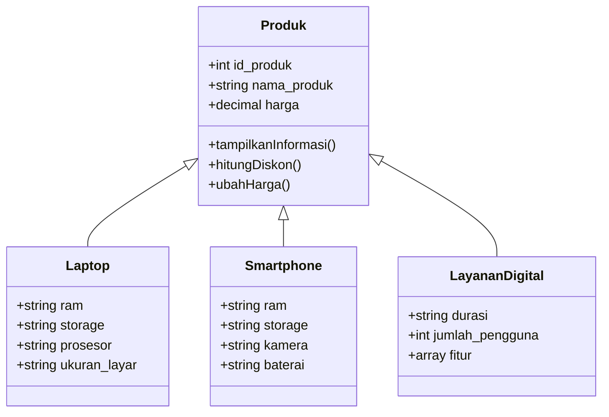

# Diagram Pemodelan Objek – Katalog Produk

Gambar: [`diagram_pemodelan.png`](diagram_pemodelan.png)

## Pemetaan ke tabel relasional

| Konsep objek | Representasi di MySQL |
| ------------ | --------------------- |
| Kelas `Produk` | Tabel `produk_objek` |
| Atribut umum (`id_produk`, `nama_produk`, `harga`) | Kolom biasa |
| Kelas turunan (Laptop, Smartphone, LayananDigital) | Kolom `jenis_produk` |
| Atribut khusus tiap kelas | Kolom JSON `spesifikasi` |
| Method | Tidak disimpan di tabel (ada di aplikasi / stored program) |
